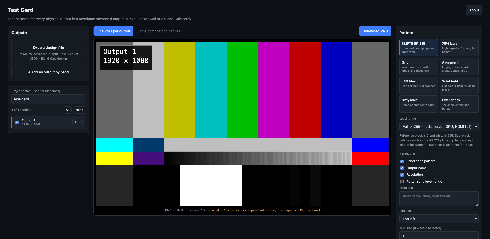
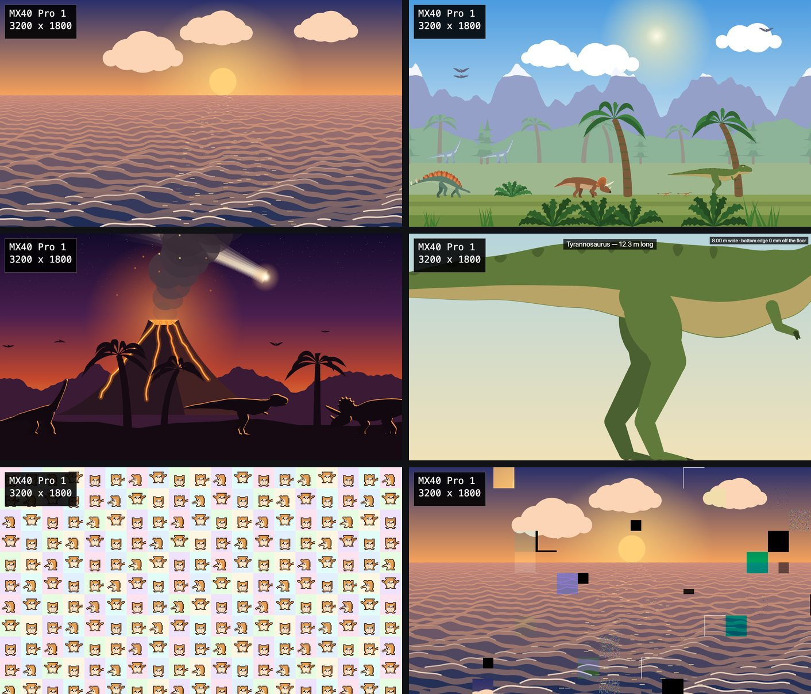

# Test Card

> **AI-assisted project.** This codebase was created with [Claude Code](https://claude.com/claude-code)
> (Anthropic), directed and reviewed by a human author. There are 215 tests in all. The RP 219
> pattern is checked against a reference *measured* from ffmpeg's `smptehdbars` rather than
> transcribed from prose descriptions of the standard, and its fifteen colours are computed through
> Rec. 709 and land exactly on those measured values, which is itself the proof the measurement is
> sound. The importers are tested against real files, and the whole path has been driven end to
> end in a browser; the Verification section has the details. The MP4 loops are made in Chrome
> and read back by ffmpeg, which decodes the bars to within one code value, and they've been
> played in Resolume Arena 7.28.1, which opens them, gets the colour right and loops them without a
> seam (but see the note on starting an H.264 clip from cold). **No image or loop it produces has
> been played out to a real projector, LED processor or display and measured.** The patterns are
> correct as pixels; what a screen does with them is something this can't tell you.

Test patterns for every physical output in a show, made from the file that already describes the
outputs.

Import a **Resolume advanced output**, a **Pixel Peeker** wall or a **Blend Calc** projector array,
and get one PNG per physical output at that output's exact raster, or a single composition-sized
image that proves the output map is what you think it is. Everything runs in the browser, and
nothing is uploaded.

It also does the other sort of test pattern: the one you put up while the client is walking in.
Rulers that measure the wall in metres, a bunch of bananas for scale, life-size dinosaurs that
don't fit, a hamster on every LED tile, and a few moving scenes that export as seamless MP4 loops.



<sub>One 1920 × 1080 output added by hand, SMPTE RP 219 bars at full range with the output name and resolution burnt in. The preview is scaled; the exported PNG is pixel-exact.</sub>

## Patterns

| Pattern | What it is for |
|---|---|
| **SMPTE RP 219** | Standard bars, +I/+Q, luma ramp and pluge. Geometry and colours measured from a real generator — see [docs/rp219.md](docs/rp219.md) |
| **75% bars** | Eight equal full-height bars. Survives being squeezed onto a narrow LED strip where RP 219's four rows would be unreadable |
| **Grid** | Your own pitch or division count, heavy lines every N, cell labels, diagonals, centre target |
| **Alignment** | 1px edge border, corner markers with pixel counts, safe areas, centre target and circles, 1px checker patches |
| **LED tiles** | One cell per cabinet. Either a uniform tile size you state, or the **real cabinet map** imported from Pixel Peeker — including irregular walls, chain order and per-port colouring |
| **Solid field** | Flat colour at a chosen level, for dead pixels and uniformity |
| **Greyscale** | Continuous ramp or stepped wedge, optionally split into R, G, B and neutral |
| **Pixel check** | 1px checkerboard and line bursts. If it renders as flat grey on the real output, something in the chain is scaling |

### Scale and novelty



<sub>Previews of a 3200 × 1800 Pixel Peeker wall at 2.5 mm. The Tyrannosaurus is 12.3 m long and the wall is 8 m wide, so you get most of him.</sub>

| Pattern | What it is for |
|---|---|
| **Rulers** | Tape measures along the edges, in metric or imperial, worked out from the pixel pitch. Each tick lands on the pixel whose centre is nearest, so it's never more than half a pitch out, and the pattern says what that is. Can read height off the floor |
| **Banana for scale** | A life-size bunch of five 19 cm bananas, once in the middle or on every LED tile, with the wall's size given in bananas. Someone was always going to ask |
| **Life-size dinosaurs** | Seven of them at their usual quoted sizes, from a 1 m Compsognathus to a 22 m Brachiosaurus, plus a 1.75 m person and a banana. Feet on the floor, pan along the line-up, and anything bigger than the wall is cut off by its edges |
| **Hamster dance** | One dancing pixel-art hamster per LED tile, in time to a tempo you set. A nod to a certain 1998 web page; the hamsters are my own |
| **Ocean waves** | Generative sea, day, sunset or night, rolling in towards you. Moves |
| **Dinosaur scroll** | A side-scrolling Cretaceous: mountains, palms, ferns, and dinosaurs walking with their feet planted on the ground that scrolls under them. Moves |
| **Volcano and comet** | An eruption, a comet on its way in, and the dinosaurs who've noticed. Moves |
| **Broken wall** | Any other pattern with a share of its tiles broken: dead tiles and modules, calibration and batch mismatches, a lost colour, the wrong RGB order, scan faults, dead pixels, mapping errors, an upside-down module, seams, a frozen tile, flicker and data noise. Optionally labelled, for training |
| **Your image** | Any picture, fitted, filled and cropped, stretched, 1:1, or tiled, anchored where you like. Kept in your browser across a refresh and never uploaded |

Every pattern can carry a burn-in (output name, resolution, pattern, plus your own text) and can
draw the imported slice or port outlines on top.

## Physical scale

The rulers, the bananas and the dinosaurs need to know how big a pixel is. A Pixel Peeker import
brings the wall's pitch with it. Anything else, type it in under **Edit** on the output, as a pitch
or as the image's width in metres (which is the easy way for a projector). An output with no pitch
is drawn at a fallback and says **pitch assumed** across the bottom, because a life-size banana at
the wrong pitch is still the wrong size, just more confidently.

**Carry on across outputs** treats the outputs as windows onto one surface, placed by where they sit
in the composition. A ruler then runs the length of the wall instead of starting again at each
processor, the sea doesn't have a seam between two projectors, and the edge-blend overlaps get the
same pixels from both sides. It does nothing to the measurement patterns: bars and grids belong to
one output's raster. LED tiles stay with their own output too, since that's where its cabinets
start. An output whose region in the composition is stretched to a different shape isn't spanned,
because nothing can be life-size both ways at once on a stretched picture; it gets its own copy.

## Moving patterns and MP4 loops

The ocean, the scroll, the volcano and the hamsters move, and so does a broken wall over any of
them (or with flicker or data noise in it). They animate in the preview and export as **H.264 MP4
loops**, encoded in the browser, one per output or one for the composition. A PNG of any frame is
still there.

The loop is fitted to whole frames first, and everything in it does a whole number of cycles in
that time: each wave, each scrolling layer, each stride and wingbeat. Frame N would be frame 0, so
the file goes round without a seam. The encoder is warmed up on the loop's last second before frame
0, because otherwise it codes the first frame differently from all the others and the wrap shows.

Colour is converted here with the Rec. 709 matrix into limited-range 4:2:0, and the file is
labelled as such. The level range means what it does for a PNG: legal-range bars keep their
sub-black and super-white in the video's footroom and headroom.

It needs a browser that can encode video (WebCodecs), an even width and height, and a raster inside
what that browser's H.264 encoder will take. I've only tried it in Chrome, where on a Mac that's 4K
and 7680 × 1080 but not 8192 × 2160. Edge should behave the same; Safari and Firefox have WebCodecs
too, but I haven't tried either. It tells you before it starts if it can't.

### In Resolume

I've played them in Arena 7.28.1 on a Mac, at 1080p and 4K. Arena opens them at the right size,
rate and length, gets the colour right (its output matches a BT.709 limited-range decode to within
a code value on average), and goes round the loop without dropping or repeating a frame.

One catch, and it's Arena's rather than the file's. An H.264 clip triggered from cold often plays
for about half a second, then holds that picture until the clip's first wrap, after which it's
fine. ffmpeg's own H.264 encodes of the same pictures do exactly the same thing; a DXV encode never
did. So for a show, either convert the loop to DXV with Alley (it comes with Arena), or trigger the
clip and let it run once round before doors.

## Two ways to render

- **One PNG per output:** each file at that output's native raster. One output downloads as a bare
  PNG; several download as a ZIP with a `manifest.txt` recording which file is which output, the
  level range used, any raster the app had to infer, and for the scale patterns each output's
  pitch and whether it was a guess. Moving patterns can do the same with MP4s.
- **Single composition canvas:** one image at composition size with every output's region drawn
  and labelled. Play it through Resolume and each physical output should light up showing its own
  name. That's the fastest proof the advanced output map matches what you think it does, and you
  don't need any way of getting a file to each output individually.

## Level range

SMPTE bars are defined in Y′CbCr, a PNG is RGB, and a PNG can't say which convention it was written
in. So the app asks, and records the answer in the manifest.

- **Full 0–255** (default): media server, GPU output, HDMI/DP set to full range. The −2% pluge patch
  clips to black and can't be judged.
- **Legal 16–235**: studio swing, for an SDI chain. Sub-black and super-white survive, so the pluge
  means something. It looks washed out on a full-range display, and it's meant to.

## Imports

[docs/importers.md](docs/importers.md) has what each file does and doesn't know. In short:

- **Resolume:** one output per `<Screen>`. The raster is read from the output device when it
  records one, and otherwise **inferred from slice bounds**, which can come out too small. Inferred
  rasters are badged in the UI and called out in the manifest; correct them by hand.
- **Pixel Peeker:** use `Export → JSON`, not `Save project`. The project file stores cabinets as
  library references in millimetres and can't be resolved to pixels here, so it's refused with a
  message naming the right export.
- **Blend Calc:** needs the projector resolution (not in the file) and, for designs using a fit
  mode, the *solved* overlap (also not in the file, because Blend Calc works it out and never writes
  it back). Both are asked for. Its Resolume XML export needs neither and is the better file to
  bring.

You can also just add outputs by hand.

## Development

```bash
npm install
npm run dev
```

```bash
npm test
```

See [CLAUDE.md](CLAUDE.md) for the full command list and [AGENTS.md](AGENTS.md)
for the invariants and the traps.

## Verification

- **RP 219:** geometry and colour checked against a reference measured from ffmpeg's
  `smptehdbars` at four resolutions, committed as `test/fixtures/rp219-ffmpeg.json` and
  reproducible with `scripts/extract-rp219-reference.py`.
- **Importers:** tested against **real files**: Arena 7.27.0's own `AdvancedOutput.xml` and a
  saved Advanced Output preset, plus exports generated by running `blend-calc`'s and
  `pixel-peeker`'s own test suites. There are no hand-written fixtures, because a fixture invented
  to match the parser only proves that the parser matches itself.
- **ZIP writer:** CRC-32 checked against the published test vector, and archives verified with the
  system `unzip` and with Python's `zipfile`.
- **End to end**, driven in a browser: a real Blend Calc export imported, six 1920x1200 PNGs
  rendered and packed, and the resulting ZIP unpacked and its PNG headers checked. Bar colours and
  pluge values were sampled off the canvas and confirmed against the standard.
- **Real size:** the drawings are held to their sizes by the tests. Each dinosaur is its quoted
  length nose to tail within 3.5% and its stated height within 6%, the banana is 190 mm along its
  curve, and the person is 1.75 m. Ruler ticks are tested to sit within half a pitch of true, on a
  wall, across a span and up from the floor.
- **MP4 writer:** a real libx264 stream (`scripts/make-h264-fixture.sh`) is muxed and read back:
  the boxes by the tests, and by ffprobe and ffmpeg where installed, which decode it to exactly
  the frames the raw stream decodes to.
- **Loops, made in Chrome 152:** 75% bars encoded from full- and legal-range pictures both decoded
  within one code value of the standard Y′CbCr bar values. Ocean, scroll, volcano, hamster and
  broken-wall loops are pixel-identical at t = 0 and t = T before encoding, and after it the step
  from the last frame back to the first is within about a tenth of a grey level of the step into
  any other keyframe of the same loop.
- **In Resolume:** Arena 7.28.1 (macOS 26.4.1) opened ocean, scroll and hamster loops at
  1920 × 1080 and an ocean at 3840 × 2160, all at 30 fps and exactly 10 s. Its output snapshot of
  frame 0 matched a BT.709 limited-range decode with a mean error of 0.90 code values at 1080p and
  0.78 at 4K, against 3.1 for BT.601. Its own recorder caught 630 consecutive output frames of the
  scroll: every source frame once and in order through two wraps, exactly 10 s apart. Triggered
  from cold, H.264 clips froze after about 0.6 s until their first wrap in 8 of 11 tries; libx264
  encodes did the same at every keyframe interval tried, all-intra included, and a DXV encode froze
  in none of 3.
- **Spanning:** the six-projector Blend Calc export rendered per output, with every surface pattern
  matching in the edge-blend overlaps apart from at most nine antialiased edge pixels.
- **Reviewed:** an independent review of the whole change before it landed found twelve problems,
  from a volcano that grew a different forest on each output to an MP4 export that crawled in a
  background tab. All twelve were fixed and the checks above re-run afterwards.

<!-- selfhost:start -->
## Run your own copy

Test Card is a static page, so hosting it yourself is one container serving
the built files — the same files the hosted copy serves, running somewhere that
still works when the venue has no internet.

**Docker.** The image is built by this repo's `docker.yml` workflow on every
push and published as `ghcr.io/stoatworks-labs/test-card`:

```bash
docker run -d --name test-card --restart unless-stopped -p 8522:80 ghcr.io/stoatworks-labs/test-card:latest
```

Or `docker compose up -d` with the [`docker-compose.yml`](docker-compose.yml)
in this repo, which maps the same port. Either way it is then at
`http://localhost:8522/`.

**Unraid.** Search Community Applications for *Test Card* — the template is
[`templates/test-card.xml`](https://github.com/stoatworks-labs/stoatworks-unraid/blob/main/templates/test-card.xml)
in [stoatworks-unraid](https://github.com/stoatworks-labs/stoatworks-unraid), which is what the CA feed reads.

**Stoatworks Burrow** lists it under *Self-hosted*, with the compose file a
click away.

The `Dockerfile`, `docker-compose.yml`, `docker/` and the workflow are
generated from `fleet.json` in stoatworks-unraid. Change them there and
regenerate rather than editing them here.
<!-- selfhost:end -->

<!-- attributions:start -->
This project is built on other people's work — see [ATTRIBUTIONS.md](ATTRIBUTIONS.md).
<!-- attributions:end -->

## Licence

MIT. There are no releases yet, so no installers: the hosted page and the container above are the
ready-made ways to run it, and the menu-bar app in [`launcher/`](launcher/README.md) builds from
source.
