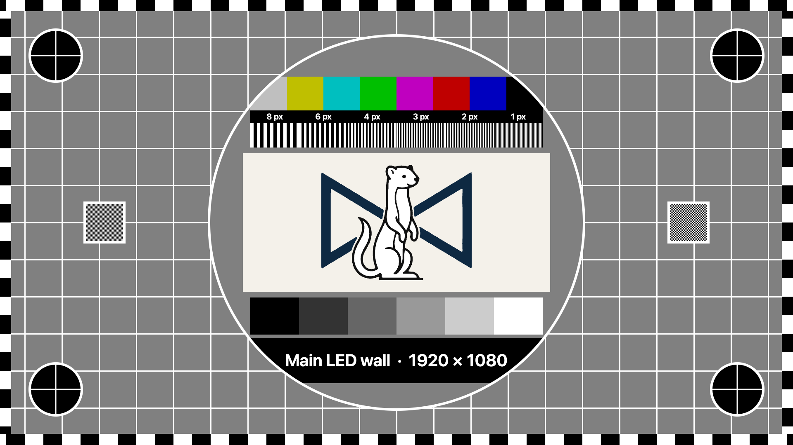
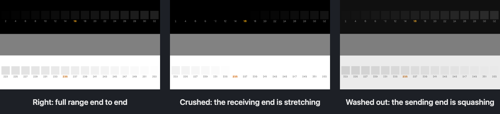
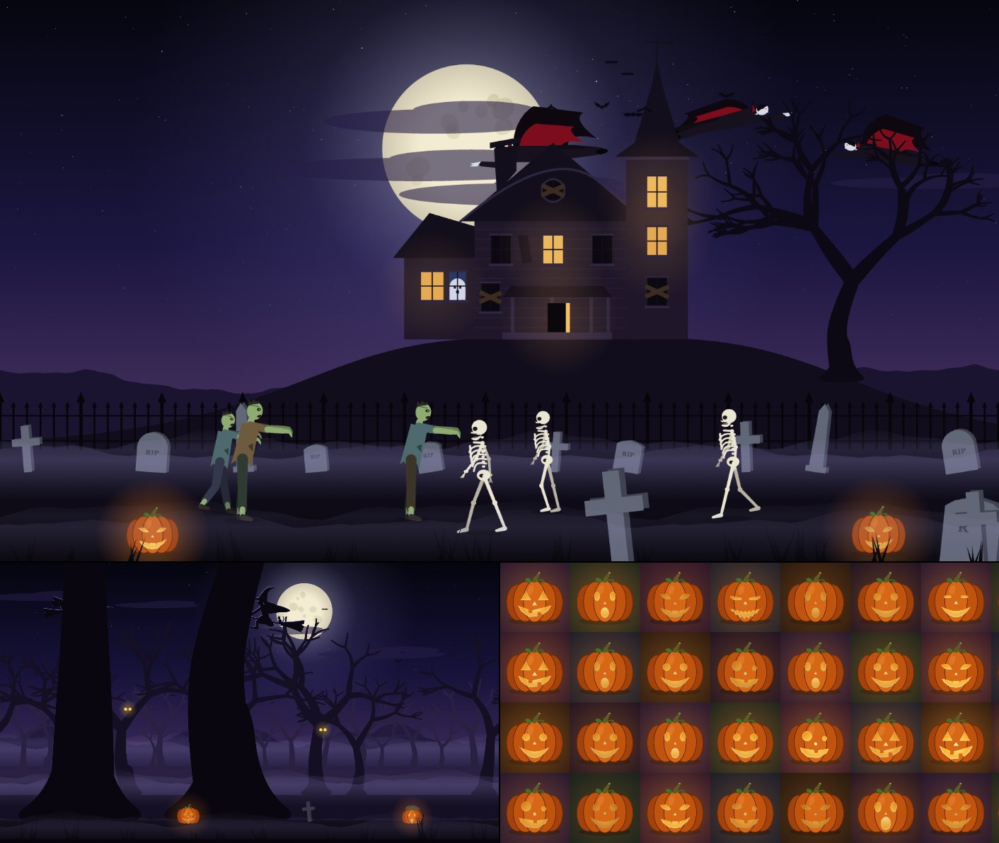
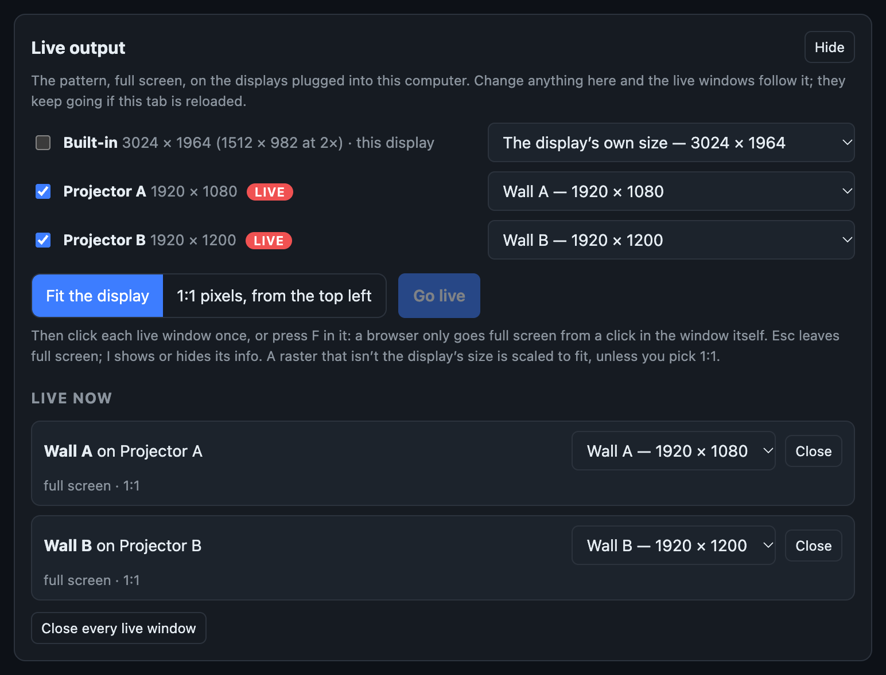

# Test Card user guide

Test Card generates test patterns for every physical output in a show, from the file that already
describes the outputs.

*One 1920 × 1080 output added by hand, SMPTE RP 219 bars at full range with the output name and resolution burnt in. The preview is scaled; the exported PNG is pixel-exact.*

Import a **Resolume advanced output**, a **Pixel Peeker** wall or a **Blend Calc** projector array,
and get one PNG per physical output at that output's exact raster, or a single composition-sized
image that proves the output map is what you think it is. Everything runs in the browser, and
nothing is uploaded.

> **Before you rely on this:** the RP 219 pattern is checked against a reference **measured** from
> a real generator at four resolutions, rather than transcribed from prose descriptions of the
> standard, and its fifteen colours are computed through Rec. 709 and land exactly on those
> measured values, which is itself the proof the measurement is sound. The importers are tested against
> **real files**, not hand-written fixtures, and the whole path has been driven end to end in a
> browser.
>
> The MP4 loops are made in Chrome and read back by ffmpeg: 75% bars come back within one code
> value of the standard, and the loops go round with no seam. They've also been played in Resolume
> Arena 7.28.1, which opens them, gets the colour right and loops them cleanly, with one catch
> covered under **Moving patterns** below. A loop too big for the browser to encode whole comes out
> as tiles; decoded and stitched back together, an 8K one matches the picture drawn whole.
>
> **Live output** has been driven in Chrome 155 with three pretend displays: it lists them, opens a
> window over each, and each goes full screen on its own display at 1:1. It hasn't been tried with
> a real second display yet.
>
> **No image or loop it produces has been played out to a real projector, LED processor or display
> and measured.** The patterns are correct as pixels; what a screen does with them is something
> this can't tell you.
>
> This codebase was created with AI assistance, directed and reviewed by a human author.

---

## The patterns

| Pattern | What it is for |
|---|---|
| **SMPTE RP 219** | Standard bars, +I/+Q, luma ramp and pluge. |
| **75% bars** | Eight equal full-height bars. Survives being squeezed onto a narrow LED strip where RP 219's four rows would be unreadable. |
| **Grid** | Your own pitch or division count, heavy lines every N, cell labels, diagonals, centre target. |
| **Alignment** | 1px edge border, corner markers with pixel counts, safe areas, centre target and circles, 1px checker patches. |
| **LED tiles** | One cell per cabinet — either a uniform tile size you state, or the **real cabinet map** imported from Pixel Peeker, including irregular walls, chain order and per-port colouring. |
| **Solid field** | Flat colour at a chosen level, for dead pixels and uniformity. |
| **Greyscale** | Continuous ramp or stepped wedge, optionally split into R, G, B and neutral. |
| **Pixel check** | 1px checkerboard and line bursts. **If it renders as flat grey on the real output, something in the chain is scaling.** |
| **Classic test card** | A grey grid, castellated edges and a big circle holding colour bars, gratings from 8 px down to 1 px, a picture panel, six greyscale steps and the output's name. See below. |
| **Levels check** | Full or limited range, and which end has it wrong. See below. |
| **AV sync** | A flash and a beep on the same frame, and a scale that reads the offset in frames. See below. |

Every pattern can carry a burn-in (output name, resolution, pattern, plus your own text) and can
draw the imported slice or port outlines on top.

### The classic test card

Laid out the way the old broadcast cards were, for the same reasons:

- **The circle** and the **corner circles** (one in each corner, where there's room) are round
  when the aspect ratio is right. An egg means something is stretching the picture.
- **The castellations** run along every edge. Count how many you can see to know how much of
  the picture overscan or a mask is eating.
- **The gratings** go from 8 px lines down to 1 px. Where they turn to mush is where the
  resolution runs out; the 1 px one (and the **checker** on the left) goes flat grey through
  anything that scales.
- **The six steps** run from black to white. Two that look the same at either end mean crushed
  blacks or clipped whites.
- **The box at the foot** names the output and its raster. Untick **Name the output** and the
  box goes.

**In the middle** is the Stoatworks logo by default. Pick **Your image** to use your own picture
(the same one the **Your image** pattern uses, kept in this browser and never uploaded), or **Your
text** for a line or two of your own: the venue, the screen, the show. The text is sized to fill
the panel. Set the panel's **Background**, and the text's colour.

The card is always drawn in full range, whatever the level setting says. For checking levels, use
the bars, the greyscale, or the **levels check**.

### The levels check

Full or limited range is the setting everybody has an opinion about and nobody can see. A GPU,
a media server output, a converter, a processor input and a display can each be set either way,
or to "auto", which means "guess", and the picture only looks right when the two ends of each
link agree.

The levels check is a row of near-black squares on black (codes 2 to 32) and a row of near-white
squares on white (223 to 253), each labelled, with the limited-range edges (16 and 235) picked
out. It's always drawn in full range, since a media server plays a full-range picture.

| What you see | What it means | What to change |
|---|---|---|
| Every square in both rows, black is black, white is white | Full range end to end (or limited at both ends, which works too) | Nothing |
| The squares from 16 down and from 235 up have gone, the coloured ones included | **Crushed.** Something is stretching 16–235 out to 0–255, so 16 lands on black, 235 on white and everything beyond clips. Usually the receiving end expecting limited; sometimes a player reading a full-range file as limited, or a converter set to expand | Set the receiver's input to full, or the sender's output to limited |
| Every square is there, but black is grey and white is dull | **Washed out.** The sending end is squashing to limited, and nothing stretches it back | Set the sender's output to full, or the receiver's input to limited |

Crushed shows itself: squares vanish. Washed out doesn't, because nothing is lost, so judge the
black against the screen switched off, or against a dark bit of set.

What one picture can't tell you is which box in a longer chain did it. Look at the card on any
monitor partway along: a media server's own preview, a processor's monitor out, a scaler's
loop-through. The fault is between the last place it looks right and the first place it looks
wrong. **Explain the results on the card** prints the table above on the pattern itself, for the
person at the other end of the radio. On an output under about 800 pixels wide the notes would be
too small to read, so they're left off and only the squares are drawn.

### AV sync

Every so often (once a second unless you change **Flash and beep every**) the pattern has a sync
frame: the side panels flash white, the hand going round the ring reaches the top, and the sound
starts a 1 kHz beep at −18 dBFS that lasts that one frame. Under the ring, boxes numbered −6 to +6
light one per frame either side of it, 0 on the sync frame itself.

To measure something: play the MP4 through it and film the screen with sound (a phone will do),
or record its output on anything that takes picture and sound together. Find where a beep starts
in the sound, step to that frame, and read the lit box. **+2** means the sound arrives two frames
after the picture; **−1**, one frame before it.

- The sound is in the **MP4**, and in **Live output**'s first window once you've clicked it. The
  preview is silent and a PNG is just a picture. Measure with the MP4: the live sound's delay
  through the browser hasn't been measured.
- Make the MP4 at the frame rate the system runs at, so a frame in the file is a frame on the
  screen.
- The middle of the ring takes the same **In the middle** settings as the classic card: the logo,
  your image, or your text.
- The file's first and last half second are quiet, so the loop's seam never falls in a beep.

How close it is: decoded by ffmpeg and by AVFoundation (what Resolume uses on a Mac), each beep
starts within a quarter of a millisecond of the start of its flash frame, at 25, 29.97 and 30 fps.
A frame is 33 to 40 ms, so the file itself is never the thing that's out.

### Scale and novelty

The other sort of test pattern: the one that's up while the client walks in, or while you're
explaining to someone what a dead module looks like.

| Pattern | What it is for |
|---|---|
| **Rulers** | Tape measures along the edges, metric or imperial, from the pixel pitch. Each tick is within half a pitch of true, and the pattern says how much that is. The side rulers can read height off the floor. |
| **Banana for scale** | A life-size bunch of five 19 cm bananas, once or on every LED tile, with the wall's size in bananas. |
| **Life-size dinosaurs** | Seven dinosaurs at their usual quoted sizes, a 1.75 m person and a banana, standing on the floor in a line. **Pan** along it, or pick one under **Centre on**. Anything bigger than the wall is cut off by its edges. |
| **Hamster dance** | One dancing pixel-art hamster per LED tile, at a tempo you set. Moves. |
| **Ocean waves** | A generative sea rolling in, day, sunset or night. **Another** picks a different sea. Moves. |
| **Dinosaur scroll** | A side-scrolling Cretaceous with dinosaurs walking on the ground that scrolls under them. Moves. |
| **Volcano and comet** | An eruption, an incoming comet, and some worried silhouettes. Moves. |
| **Broken wall** | Another pattern with a share of its tiles broken in fifteen different ways, from a dead tile to a wrong RGB order. Tick **Label each fault** to name them on the wall. |
| **Your image** | Any picture, fitted, filled and cropped, stretched, 1:1 or tiled. It stays in this browser across a refresh and is never uploaded. |

The per-tile patterns (bananas per tile, hamsters, pumpkins, the broken wall) use the same tiles as
the **LED tiles** pattern: a uniform size you state, or the cabinets from a Pixel Peeker import.

### Halloween

Three more for the time of year when someone asks whether the wall can do "something spooky"
between the bands.

| Pattern | What it is for |
|---|---|
| **Pumpkin patch** | A jack-o'-lantern on every LED tile, each carved with one of six faces: classic, fierce, happy, surprised, sly (with fangs) and goofy. Tick the faces you want; **Seed** deals them out. **Candles flicker** and **Blinks, winks and chomps** are the two things that move; untick both and it's a still. Untick every face and the pumpkins are plain. |
| **Spooky forest** | A night wood scrolling past in five layers of parallax: far hills, mist, three depths of dead trees (the middle one has eyes in it), lanterns on the ground, and witches and bats crossing the moon. **Seed** and **Speed** are shared with the dinosaur scroll. Moves. |
| **Haunted house** | A house on a hill with candles in its windows, a ghost in one of the dark ones once a loop, bats round the spire, vampires flying round the back, and zombies and skeletons walking the graveyard in opposite directions. **Seed** rearranges it. Moves. |

Like the other scenes, the forest and the house carry on across outputs when **Carry on across
outputs** is ticked. The zombies and skeletons go round once per loop, so a longer loop makes them
walk slower; at 10 s they're a bit brisk for the undead.

---

## Physical scale: give it a pitch

The rulers, the bananas and the dinosaurs are drawn at real size, so they need to know how big a
pixel is.

- A **Pixel Peeker** import brings the wall's pitch with it.
- For anything else, open **Edit** on the output and type the **pixel pitch** in millimetres, or
  the image's **width in metres** and let it work the pitch out. For a projector, the width is the
  one you'll know.
- An output with neither is drawn at the **fallback pitch** in the pattern panel and says **pitch
  assumed** across the bottom. The ZIP manifest lists each output's pitch and marks the guesses.

**Bottom edge above the floor** puts the dinosaurs' feet on the real floor rather than on the
bottom of the wall. A wall flown a metre up shows their knees, not their toes.

**Carry on across outputs** treats the outputs as windows onto one surface, placed by where they sit
in the composition, so a ruler runs the whole wall and the sea has no seam between two projectors.
It only applies to the scale and novelty patterns; bars and grids always belong to one output, and
LED tiles stay with the output whose cabinets they are. An output stretched to a different shape in
the composition isn't spanned and gets its own copy instead.

---

## Moving patterns: MP4 loops

The moving patterns animate in the preview (**Pause** freezes it on the frame the PNG will use) and
get a **Download MP4 loop** button. Set the length and frame rate under **Loop**.

**Download PNG** is still there for every one of them: it gives you a single still per output, the
frame at **PNG shows the frame at (s)**. Pause the preview to see which frame that is.

- The loop goes round with no seam: everything in it does a whole number of cycles in the loop's
  exact length, which is a whole number of frames.
- It's H.264, encoded in your browser. That needs WebCodecs; I've only tried it in Chrome.
- Colour is BT.709, limited range, converted here and labelled in the file. Legal-range bars keep
  their sub-black and super-white.
- **Bitrate** at 0 picks a generous one for the raster. Set your own if the files are too big.
- Big rasters take a while: the export shows its progress and has a **Cancel**. It keeps going at
  the same speed behind another tab.
- A loop that would come to more than about 1 GB is refused before it starts, since the whole file
  has to fit in the browser tab's memory.
- **Too big for one video:** Chrome stops at 4096 × 2304 worth of picture, in any shape, so a
  bigger raster comes out as a grid of **tiles**: 8K is four 3840 × 2160. A note above
  the preview says which outputs will be tiled and how, and the button says it's a ZIP. Each tile
  is its own seamless loop of the same length; the manifest and each file name
  (`…_tile-r1c2_3840x2160+3840+0.mp4`: row, column, size, then x and y) say where it goes. Place
  them at those positions and play them together. A bitrate you've set is shared between the
  tiles; auto is worked out per tile.

**In Resolume.** Arena 7.28.1 plays them at the right size, rate and length, with the right colour,
and loops them without dropping or repeating a frame. The catch: an H.264 clip triggered from cold
often plays for about half a second and then holds that picture until its first wrap. That's
Arena's H.264 playback, not this file (ffmpeg's own H.264 encodes do the same; DXV doesn't). Before
a show, convert the loop to **DXV** with Alley, which comes with Arena, or trigger the clip and let
it run once round.

---

## Two ways to render, and when each is the right one

**One PNG per output**, each at that output's native raster. One output downloads as a bare PNG;
several download as a ZIP with a `manifest.txt` recording which file is which output, the level
range used, and any raster the app had to infer.

**Single composition canvas:** one image at composition size with every output's region drawn and
labelled. Play it through Resolume and each physical output should light up showing its own name.

That second one is the fastest proof the advanced output map matches what you think it does, and
you don't need any way of getting a file to each output individually, which on a show day is often
the actual problem.

---

## Live output: straight to the displays

**Live output**, beside the download buttons, puts the pattern full screen on the displays plugged
into this computer, with no file in between. It's for when the laptop is the source: plugged into
the projectors or the LED processor, or bars on a monitor before anything else is rigged.

*Three displays listed. Each projector got the output that's its size, and both are live, full
screen at 1:1; the laptop's own screen is left out.*

1. Press **Live output**. In Chrome or Edge, **Find my displays** asks whether the page may manage
   windows on all your displays. Say yes and it lists them, each with its raster in device pixels.
   On Windows at 125% or 150% the browser only knows that to a pixel or so, and says "about".
2. Tick the displays to use and choose what each one **Shows**: an output from your list, the whole
   composition, or **The display's own size**, which needs no import at all. An output that's the
   same size as a display goes to that display by itself.
3. Press **Go live**. A window opens over each display.
4. Click each window once, or press **F** in it, and it goes full screen on its display.

Browsers won't let a page do two things, which is why there's clicking involved:

- **One window per click.** The first display's window opens and the panel says which didn't. Press
  **Go live** again for each one left, or allow pop-ups for the site (the icon at the right of the
  address bar) and they'll all open at once.
- **Full screen needs a click in the window itself.** Nothing the editor does can do it for you.

Once they're up:

- The live windows follow the editor. Change the pattern, the burn-in, the outputs or the picture
  and they change with it. Each is a page of its own, so reloading or closing the editor tab leaves
  them running, and the editor finds them again when it comes back.
- **Live now** lists each window: what it shows, whether it's full screen, 1:1 or scaled, and the
  frame rate of a moving pattern. You can change what one shows, mute it, or close it from there.
- **Fit the display** scales a raster that isn't the display's size until it fills it, and the
  window says by how much (scaled, 1px detail is approximate). **1:1 pixels, from the top left**
  never scales, and crops a raster that's bigger than the display.
- In a window, **Esc** leaves full screen and **I** shows or hides the info. The pointer hides
  itself once it's full screen.
- Moving patterns play live. Every window works out where it is in the loop from the computer's
  clock, so a scene spanning several outputs stays in step across them.
- AV sync's beep comes from the first window opened, once it's been clicked (a browser won't make a
  sound before that). The sound is put back in step with the picture every time round the loop.
- A live window stops the display going to sleep. Where the browser won't allow that (on plain
  http, for one), the window says so, and you'll want display sleep off by hand.

Without the display list (Safari, Firefox, the permission refused, or a copy opened over plain http
from another machine, as the desktop app's is), **Open a live window** opens one here. Drag it to
its display and click it.

**A Mac at a scaled resolution.** Set a display to anything but its default in System Settings and
macOS draws a bigger picture than the display takes, then shrinks it to fit the signal. The
browser only sees the bigger picture, so the panel lists that size, and "1:1" in the window means
1:1 with it, not with the cable. Put the display on its default resolution for a pixel check.
Projectors and LED processors usually come up that way anyway.

**What it can't tell you.** I haven't measured what comes out of the computer's video port. The
browser and the operating system colour-manage everything on screen to the display's colour
profile, so the code values on the cable may not be the PNG's. Live output is for checking the map,
the geometry, the scaling and the pixel check; for levels, the pluge and exact bar values, play the
PNG or MP4 from the media server. The same goes for AV sync: the browser adds its own delay to the
picture and to the sound, which nobody has measured, so to measure a system, play the MP4.

---

## Level range: the app asks because a PNG cannot say

SMPTE bars are defined in Y′CbCr. A PNG is RGB, and a PNG can't record which convention it was
written in. So the app asks, and writes the answer into the manifest.

- **Full 0–255** (default): media server, GPU output, HDMI/DP set to full range. **The −2% pluge
  patch clips to black and can't be judged.**
- **Legal 16–235**: studio swing, for an SDI chain. Sub-black and super-white survive, so the pluge
  means something. It looks washed out on a full-range display, and it's meant to.

Pick the one that matches the chain the file is going down, not the one that looks right on your
laptop.

---

## Imports, and what each file does not know

**Resolume:** one output per screen. The raster is read from the output device when it records
one, and otherwise **inferred from slice bounds, which can come out too small.** Inferred rasters
are badged in the UI and called out in the manifest, so correct them by hand.

**Pixel Peeker:** use **Export → JSON**, not *Save project*. The project file stores cabinets as
library references in millimetres and can't be resolved to pixels here, so it's refused with a
message naming the right export, rather than half-imported.

**Blend Calc:** needs the projector resolution (not in the file) and, for designs using a fit mode,
the **solved** overlap (also not in the file, because Blend Calc works it out and never writes it
back). Both are asked for. Its Resolume XML export needs neither and is the better file to bring.

You can also just add outputs by hand.

---

## If something is wrong

| Symptom | Cause |
| --- | --- |
| **The pixel-check pattern is flat grey on the output** | Something in the chain is scaling. That is exactly what the pattern is for. |
| **An output's raster looks too small** | It was inferred from slice bounds. It is badged; correct it by hand. |
| **A Pixel Peeker file is refused** | It is a project save, not the JSON export. |
| **The pluge patch is invisible** | Full-range levels clip it to black. Render at legal range for an SDI chain. |
| **The bars look washed out** | Legal-range content on a full-range display. Correct, not broken. |
| **Blend Calc import asks for numbers** | The projector resolution and the solved overlap are not in that file. Bring its Resolume XML instead. |
| **"Pitch assumed" across the bottom** | The output has no pixel pitch. Set it under **Edit**, or the life-size things are only as right as the fallback. |
| **The dinosaurs' feet are missing** | The wall's bottom edge is off the floor, and so are their feet. Set **Bottom edge above the floor** to 0 to see them. |
| **No MP4 button** | The pattern doesn't move. A broken wall moves if its picture does, or with flicker or data noise ticked. |
| **"H.264 needs an even width and height"** | 4:2:0 video can't carry an odd raster. Export PNGs, or check the raster. |
| **The MP4 comes as a ZIP of tiles** | The raster is bigger than this browser will encode as one video. Place each tile where its name and the manifest say. |
| **"…will not take … Mb/s at …"** or **"… Mb/s is more than H.264 allows"** | The bitrate is too high for that raster. Lower it, or set 0 for auto. |
| **"…will not make H.264 at … fps at any size"** | This browser's encoder can't do that frame rate. Try another, or a current Chrome or Edge, or export PNGs. |
| **"…will not take …, whole or cut into as many as 64 tiles"** | Too big for this browser's encoder even in 64 pieces. Export PNGs. |
| **An MP4 freezes after half a second in Resolume, then carries on at the wrap** | Arena's H.264 playback from cold, not the file. Convert it to DXV with Alley, or let it run once round before the show. |
| **"That loop would be about … GB"** or **"Those … loops would come to about … GB"** | Too long, too big or too high a bitrate to build in a tab, every tile and output in the ZIP counted. Shorten the loop, lower the bitrate, or export fewer outputs at a time. |
| **Only one live window opened** | A browser lets a page open one window per click. Press **Go live** again, or allow pop-ups for the site. |
| **A live window won't go full screen** | It needs a click, or F, in that window. The editor can't do it for you. |
| **"scaled …%" in a live window** | The raster isn't the display's size. Give it the output that matches, **The display's own size**, or pick 1:1. |
| **Live output has no display list, only "Open a live window"** | Not Chrome or Edge, the permission was refused, or the page is on plain http. Drag the window to its display instead. |
| **"can't stop the display sleeping here"** | The browser wouldn't hold a wake lock (it needs https or localhost). Turn display sleep off by hand. |
| **A live 1:1 pixel check is soft on a Mac** | The display is on a scaled resolution, so macOS is resizing it. Put it back on its default. |
| **Live bars measure wrong on a scope** | The browser's and the OS's colour management. For levels, play the PNG from a media server. |
| **The image has gone** | It's kept in this browser's storage. Another browser, a private window or cleared site data won't have it. |
